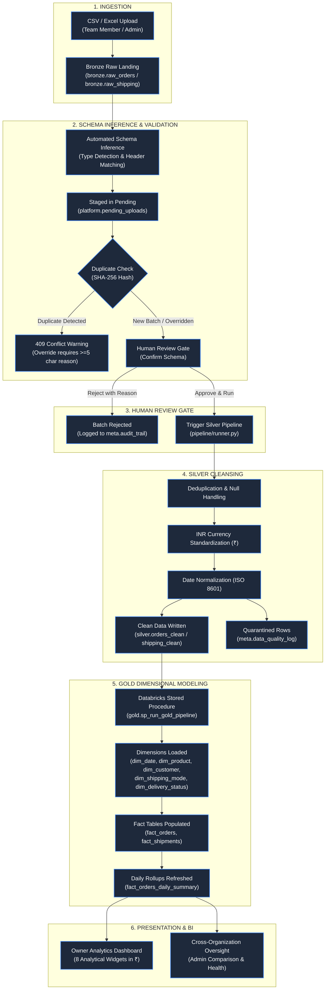
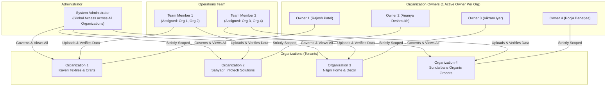

# Helios: An Enterprise Data Warehouse and Business Intelligence Solution for E-Commerce and Supply Chain Analytics

> **A multi-organization platform using the Medallion architecture on Databricks, with role-based access for Indian small and medium businesses.**

[]()
[]()
[]()
[]()
[-green.svg)]()

---

## Table of Contents

1. [Overview](#1-overview)
2. [Key Features by Role](#2-key-features-by-role)
3. [How It Works](#3-how-it-works)
4. [Architecture and Technology Stack](#4-architecture-and-technology-stack)
5. [Data Model and Schemas](#5-data-model-and-schemas)
6. [Project Structure](#6-project-structure)
7. [Prerequisites](#7-prerequisites)
8. [Setup and Configuration](#8-setup-and-configuration)
9. [Running the Platform](#9-running-the-platform)
10. [Demo Data and Ingestion Formats](#10-demo-data-and-ingestion-formats)
11. [Test Accounts and Credentials](#11-test-accounts-and-credentials)
12. [Verification Suite](#12-verification-suite)
13. [Observability and Telemetry](#13-observability-and-telemetry)
14. [Security Architecture](#14-security-architecture)
15. [Feature Status Matrix](#15-feature-status-matrix)
16. [System Limitations](#16-system-limitations)
17. [Screenshots](#17-screenshots)
18. [Team and Academic Information](#18-team-and-academic-information)

---

## 1. Overview

Small and medium-sized e-commerce enterprises generate valuable transaction, inventory, and shipment data on a daily basis. However, these businesses rarely have dedicated data engineering teams, warehouse infrastructure, or the budget to build custom ETL pipelines and analytics portals. As a result, critical operational data remains siloed in raw CSV and Excel spreadsheets, leading to blind spots in inventory management, shipping delay diagnosis, customer retention, and profitability tracking.

Helios solves this problem by providing a managed, multi-organization cloud data platform powered by the Databricks Lakehouse and Medallion architecture. The system ingests raw transaction files, performs automated schema inference and quality cleaning, models data into dimensional star schemas, and delivers real-time business intelligence dashboards formatted specifically for the Indian market. The platform is designed for two primary user groups: **Small and Medium Business Owners** who monitor revenue and delivery performance, and **Operations Team Members and Administrators** who manage ingestion validation, schema matching, and platform health.

> **Terminology Note**: In this platform, an **Organization** represents an onboarded business entity (e.g., Kaveri Textiles & Crafts). In the underlying codebase, API routes, database schemas, and configuration files, an organization is referred to as a **`tenant`** (e.g., `tenant_id`, `platform.tenants`), and an Organization Owner is internally typed as **`smb_owner`**. The user-facing application consistently presents the terminology **Organization** and **Organization Owner**.

---

## 2. Key Features by Role

Helios provides dedicated interfaces tailored strictly to the operational boundaries of each user role:

### Organization Owner (`smb_owner`)
* **Welcome Portal (`/client/home`)**: Welcome banner, active organization status, and quick links to core dashboards and support channels.
* **Store Performance & Analytics Dashboard (`/client/dashboard`)**: Eight real-time analytical widgets showing Gross Revenue, Net Profit, Average Order Value (AOV), Profit Margin, Category Revenue breakdown, Customer Segments, Month-over-Month growth, and Shipping Mode distributions. All monetary values are rendered in Indian Rupees (`₹`) with Indian numbering conventions (Lakhs and Crores), along with a prominent `Data as of` source timestamp.
* **Submission History (`/client/history`)**: Chronological audit of all past data batches, ingestion statuses (`Ready`, `Processing`, `Pending Review`), and record counts.
* **Data Export (`/client/export`)**: Direct download of cleaned datasets and executive summary reports in CSV and PDF formats.
* **Support & Update Requests (`/client/support`)**: Integrated ticketing channel to submit inquiries and update requests directly to operations staff.
* **Notifications & Alerts (`/client/notifications`)**: Real-time in-app notifications detailing batch ingestion completion, pipeline milestones, and action alerts.
* **User & Organization Profile (`/client/profile`)**: Manage personal details (name, phone) and organization metadata (business name, registered address, 6-digit PIN code, state selection, and 15-character GSTIN).
* *Note*: Organization Owners have read-only consumption access to processed data; data entry is managed exclusively by operations staff to prevent unvalidated source writes.

### Operations Team Member (`team_member`)
* **Operations Home (`/team/home`)**: Overview of assigned organizations, pending files, open support tickets, and recent ingestion runs.
* **Data Ingestion Portal (`/team/upload`)**: Upload CSV and Excel (`.xlsx`) order and shipping files on behalf of assigned organizations.
* **Pending Uploads Console (`/team/uploads`)**: View uploaded files in staging, inspect inferred schemas, review duplicate warnings, approve batches for pipeline execution, or reject batches with mandatory documented reasons.
* **Pipeline Health & Telemetry (`/team/pipeline-health`)**: Stage-by-stage monitoring (`bronze_ingest`, `schema_inference`, `human_review`, `silver_cleaning`, `gold_transform`), duration tracking, cancellation of in-flight jobs, retry from failed stages, and initiation of full restarts.
* **Data Quality & Rejection Audit (`/team/data-quality`)**: Inspect rule violations (currency anomalies, missing fields, out-of-range values, invalid dates), filter by severity, and download quarantined rows as CSV with UTF-8 BOM encoding.
* **Support Inbox (`/team/support`)**: Triage and resolve operational tickets and correction requests submitted by organization owners.
* **Assigned Organizations (`/team/tenants`)**: View details and contact info for businesses assigned to the operator.
* **User Profile (`/team/profile`)**: Update personal contact details and review active tenant assignments.

### System Administrator (`admin`)
* **Admin Home Console (`/admin/home`)**: Platform-wide metrics (active/inactive organizations, active owners, team members, pending uploads, open tickets), top 10 organizations by revenue chart, 14-day pipeline success/failure trend, and recent platform activity.
* **Pending Ingestion & Approvals (`/admin/uploads`)**: Global oversight of all staged files across all organizations with approval, rejection, and duplicate override authority.
* **Organization Governance (`/admin/tenants`)**: Onboard new organizations, edit organization parameters, deactivate/reactivate organizations, assign owners under the strict **1-active-owner-per-organization** constraint, and trigger temporary password resets.
* **Team Management (`/admin/team`)**: Onboard team members, edit staff metadata, deactivate accounts, and manage multi-organization assignments.
* **Cross-Organization Oversight (`/admin/oversight/*`)**:
  * *Organization Health (`/admin/oversight/health`)*: Cross-organization SLA compliance, ingestion recency, and pipeline error rates.
  * *Organization Comparison (`/admin/oversight/compare`)*: Benchmark revenue, order volumes, and margins across organizations.
  * *Platform Usage (`/admin/oversight/usage`)*: Monitor storage volume, pipeline runs per day, and record throughput.
  * *View-As Organization Dashboard (`/admin/oversight/dashboard/:id`)*: Inspect any organization's exact analytical dashboard view for auditing and support.
* **System Audit Trail (`/admin/audit`)**: Immutable log of administrative mutations, security events, batch overrides, and credential resets, with actor filtering and structured JSON change diffs.
* **Global Access**: Unrestricted access to upload data, manage support tickets, review pipeline health, download rejected records, and update profile settings.

---

## 3. How It Works

### Ingestion and Transformation Pipeline Flow



#### Detailed Pipeline Stages:
1. **Upload & Staging**: An operator uploads order or shipping data in CSV or Excel format. The file is parsed into memory and written directly into Bronze Delta tables (`bronze.raw_orders`, `bronze.raw_shipping`) with batch metadata.
2. **Schema Inference & Duplicate Detection**: Helios detects column headers using fuzzy matching algorithms, infers types (dates, integers, currencies), and hashes file contents using SHA-256. If duplicate content is identified, a 409 Conflict warning is raised with overlapping record metrics; operators may override the duplicate by supplying an audit reason.
3. **Human Review Gate (Approve / Reject)**: Ingestion engineers inspect inferred column mappings against the platform data dictionary. Operators may adjust mappings and click **Approve & Run**, or **Reject** the batch with a required explanatory reason.
4. **Silver Cleansing & Quality Quarantining**: The backend pipeline runner executes deduplication, replaces null values with business defaults, converts varied currency formats (`$`, `USD`, `Rs`, `INR`) to standard Indian Rupees (`₹`), and normalizes dates. Perfectly cleansed rows are written to `silver.orders_clean`, while malformed rows are quarantined into `meta.data_quality_log` and made available for CSV download.
5. **Gold Dimensional Modeling**: The backend invokes the Databricks stored procedure `CALL gold.sp_run_gold_pipeline(tenant_id, batch_id)`. The procedure executes star-schema dimensional merges into `gold.dim_product`, `gold.dim_customer`, `gold.dim_shipping_mode`, and `gold.dim_delivery_status`, merges transactional records into `gold.fact_orders` and `gold.fact_shipments`, and refreshes pre-aggregated metrics in `gold.fact_orders_daily_summary`.
6. **Dashboard Refresh & Notifications**: Upon Gold completion, the in-memory dashboard cache is evicted, the batch state transitions to `success` in `platform.pipeline_status`, and in-app notifications alert the Organization Owner that new analytics are ready.

### Multi-Tenant Role Hierarchy



---

## 4. Architecture and Technology Stack

### Component Versions & Technology Matrix

| Layer | Technology | Version | Purpose |
| :--- | :--- | :---: | :--- |
| **Frontend Framework** | React | `^18.3.1` | Component-driven user interface with strict role separation |
| **Frontend Routing** | React Router DOM | `^6.28.0` | Client-side routing, protected navigation guards, and role redirects |
| **Frontend Tooling** | Vite | `^6.0.3` | High-speed frontend dev server and production Rollup bundling |
| **Styling & Theme** | Tailwind CSS | `^3.4.16` | Responsive design system supporting dark and light color modes |
| **Data Visualization** | Recharts | `^2.15.0` | Analytical dashboard charts (bar charts, line graphs, pie charts) |
| **HTTP Client** | Axios | `^1.7.9` | REST communication with automatic JWT Bearer token injection |
| **Schema Validation** | Zod & React Hook Form | `^3.24.1` / `^7.54.2` | Client-side form input validation and error handling |
| **Icons** | Lucide React | `^0.468.0` | Visual iconography across all layout sidebars and controls |
| **Backend Framework** | FastAPI | `>=0.111.0` | Asynchronous high-throughput Python web framework with OpenAPI docs |
| **ASGI Web Server** | Uvicorn | `>=0.30.0` | Asynchronous server implementation running FastAPI endpoints |
| **Data Serialization** | Pydantic | `>=2.7.0` | Strict request/response validation and typed data schemas |
| **Data Warehouse Driver** | Databricks SQL Connector | `>=3.1.0` | Python Thrift client querying Databricks Unity Catalog Delta tables |
| **Data Manipulation** | Pandas & PyArrow | `>=2.0.0` / `>=14.0.0` | High-performance columnar dataset processing and cleaning |
| **Spreadsheet Engine** | OpenPyXL | `>=3.1.2` | Native Microsoft Excel (`.xlsx`) parsing and schema extraction |
| **Document Reporting** | ReportLab | `>=4.0.0` | Automated executive PDF report rendering for dashboard metrics |
| **Security & Hashing** | Passlib & Bcrypt | `>=1.7.4` / `4.0.1` | Salted SHA-256 password hashing with brute-force resistance |
| **Token Authentication** | PyJWT | `>=2.8.0` | Signed HS256 JSON Web Tokens with stateless role claims |
| **Data Lakehouse** | Databricks Unity Catalog | Free / Serverless | Managed Delta Lake storage and star-schema dimensional modeling |
| **Containerization** | Docker & Docker Compose | Compose v2 | Multi-container local orchestration (Backend, Frontend, Demo DBs) |

### Tenant Isolation Architecture

Organization data isolation in Helios is enforced through a **strict application-level query isolation model**. In this model, every SQL query constructed by backend repositories explicitly injects a parameterized `WHERE tenant_id = :tenant_id` clause. When an authenticated user initiates an API request, the user's validated `tenant_id` is extracted directly from the verified cryptographic claims of their JWT token. For Organization Owners, cross-tenant queries are blocked at the repository boundary with HTTP 403 Forbidden. For Operations Team Members, access is restricted strictly to assigned organization IDs retrieved from `platform.team_assignments`. System Administrators hold global authorization to query across all tenant IDs.

*Note on Unity Catalog Row Filters*: While foundational SQL definitions for Unity Catalog Row-Level Security (RLS) exist in `database/platform/row_filters.sql`, active row filter enforcement at the Databricks engine level is disabled to ensure 100% operational compatibility with Databricks Free Edition and Community workspaces, where enterprise security filter features may not be enabled. Defense-in-depth isolation is guaranteed via repository parameterization.

---

## 5. Data Model and Schemas

Helios organizes data across five distinct schemas within the Databricks Unity Catalog catalog (`helios_catalog`), comprising **24 Delta tables** and **9 Gold stored procedures**:

### Schemas and Table Breakdown

```
helios_catalog
├── bronze (2 tables)
│   ├── raw_orders                       # Raw ingested order batch staging
│   └── raw_shipping                     # Raw ingested shipment batch staging
├── silver (2 tables)
│   ├── orders_clean                     # Deduplicated, normalized, INR-standardized orders
│   └── shipping_clean                   # Cleansed shipment events and delivery days
├── gold (8 tables + 9 stored procedures)
│   ├── dim_date                         # Date dimension with Indian fiscal quarters
│   ├── dim_product                      # Product dimension with category hierarchies
│   ├── dim_customer                     # Customer dimension with consumer segments
│   ├── dim_shipping_mode                # Shipping mode classification dimension
│   ├── dim_delivery_status              # Delivery performance status dimension
│   ├── fact_orders                      # Order transaction fact table (star schema)
│   ├── fact_shipments                   # Fulfillment and transit duration fact table
│   └── fact_orders_daily_summary        # Pre-aggregated daily revenue, profit & orders rollup
├── platform (9 tables)
│   ├── tenants                          # Organizations registry (status, metadata, GSTIN)
│   ├── users                            # Platform users, hashed credentials, roles, lockout state
│   ├── team_assignments                # Team member to organization mapping table
│   ├── pending_uploads                  # Staged files awaiting schema confirmation and review
│   ├── db_connections                  # RDBMS connection configurations (AES-encrypted)
│   ├── pipeline_status                  # Stage-by-stage pipeline execution state and heartbeats
│   ├── inferred_schema                  # Inferred column mappings and data types
│   ├── notification_log                 # In-app notification delivery log
│   └── support_messages                 # Support desk tickets and thread messages
└── meta (3 tables)
    ├── etl_audit_log                    # Low-level pipeline execution audit log
    ├── data_quality_log                 # Quarantined invalid rows with rule violation codes
    └── audit_trail                      # Administrative mutations and security events
```

*Data Dictionary Reference*: All table schemas, data types, nullability constraints, and foreign key references are defined canonically in the SQL scripts located under the `database/` directory.

---

## 6. Project Structure

```
c:\Project\Helios
├── backend/                       # FastAPI application, repositories, schemas, and services
│   ├── app/
│   │   ├── api/                   # REST route controllers (/auth, /dashboard, /uploads, etc.)
│   │   ├── core/                  # Security, dependencies, configuration, and sorting utilities
│   │   ├── db/                    # Databricks SQL connection pool and lifecycle management
│   │   ├── repositories/          # Parameterized SQL data access layer with tenant isolation
│   │   ├── schemas/               # Typed Pydantic request and response models
│   │   └── services/              # Business logic, duplicate detection, and caching services
│   ├── tests/                     # Backend unit and integration test suite
│   ├── Dockerfile                 # Container build specification for backend API
│   └── requirements.txt           # Python dependency specifications
├── frontend/                      # React 18 single-page application
│   ├── src/
│   │   ├── components/            # Reusable UI controls, widgets, topbar, and sidebars
│   │   ├── config/                # Client feature flags (e.g., ENABLE_DB_CONNECTION)
│   │   ├── context/               # Authentication, theme, and application state providers
│   │   ├── hooks/                 # Custom React hooks (useAuth, useTheme, useBasePath)
│   │   ├── layouts/               # Role-based shell layouts (AdminLayout, TeamLayout, ClientLayout)
│   │   ├── pages/                 # Route page components categorized by user role
│   │   ├── routes/                # Route definitions and protected navigation guards
│   │   ├── services/              # Axios API service clients
│   │   └── utils/                 # Indian currency (INR), number, and date formatters
│   ├── Dockerfile                 # Multi-stage production build (Node compile + Nginx serve)
│   └── package.json               # Frontend dependencies and build scripts
├── database/                      # Databricks Unity Catalog SQL schema definitions
│   ├── bronze/                    # DDL scripts for raw landing tables
│   ├── silver/                    # DDL scripts for cleansed Delta tables
│   ├── gold/                      # DDL scripts for dimensions, facts, and stored procedures
│   ├── platform/                  # DDL scripts for platform control plane tables
│   ├── meta/                      # DDL scripts for logging, quality, and audit trails
│   ├── 00_catalog_setup.sql       # Initial catalog and schema initialization
│   └── run_all.py                 # Automated SQL deployment runner
├── pipeline/                      # Data pipeline execution engine
│   ├── cleaning/                  # Silver cleansing, currency parsing, and deduplication
│   ├── ingestion/                 # Bronze file readers and batch loaders
│   ├── schema_inference/          # Column matching and data type inference engine
│   └── runner.py                  # End-to-end pipeline orchestrator and heartbeat runner
├── demo-db/                       # Initialization scripts for demonstration databases
│   ├── mysql/init.sql             # Demo MySQL database schema and records
│   └── postgres/init.sql          # Demo PostgreSQL database schema and records
├── docs/                          # Project documentation and visual artifacts
│   └── screenshots/               # Interface proof screenshots and capture guidelines
├── resources/                     # Databricks Asset Bundle (DAB) Lakeflow Job specifications
├── scripts/                       # Operational, maintenance, and verification scripts
│   ├── data/                      # Indian demo data files (10 orgs) and loading scripts
│   ├── maintenance/               # System repair, schema alteration, and diagnostic tools
│   ├── verify/                    # Comprehensive verification test suite (Checks 1 to 10)
│   ├── bootstrap_admin.py         # Initial administrative user creation script
│   └── seed_accounts.py           # Standard demonstration accounts seed script
├── docker-compose.yml             # Orchestration configuration for all containerized services
├── .env.example                   # Environment variable template with documentation
└── README.md                      # Primary project documentation
```

---

## 7. Prerequisites

Before installing and running Helios, ensure your environment meets the following requirements:

* **Python**: Version `3.11` or `3.12` (tested with Python `3.12.10`).
* **Node.js**: Version `18.x`, `20.x`, or `24.x` (tested with Node `v24.14.1` and npm `11.11.0`).
* **Docker & Docker Compose**: Docker Desktop with Compose v2 (required for containerized deployment; optional for local standalone execution).
* **Databricks Workspace**: A Databricks workspace with Unity Catalog enabled (Databricks Free Edition / Community Edition or Serverless SQL Warehouse is sufficient).
* **Required Databricks Credentials**:
  1. `DATABRICKS_SERVER_HOSTNAME`: Hostname of your Databricks workspace (e.g., `dbc-xxxxxxxx-xxxx.cloud.databricks.com`).
  2. `DATABRICKS_HTTP_PATH`: Endpoint path of your SQL Warehouse (e.g., `/sql/1.0/warehouses/xxxxxxxxxxxxxxxx`).
  3. `DATABRICKS_TOKEN`: Personal Access Token (PAT) with query execution privileges.

---

## 8. Setup and Configuration

### 1. Clone the Repository
```bash
git clone https://github.com/heetdadhania/Helios.git
cd Helios
```

### 2. Configure Environment Variables
Copy the template configuration file to `.env`:
```bash
cp .env.example .env
```

<details>
<summary><strong>Click to view the full Environment Variable Reference (23 variables)</strong></summary>

| Variable Name | Required | Default / Example | Purpose |
| :--- | :---: | :--- | :--- |
| `ENVIRONMENT` | Yes | `development` | Runtime environment mode (`development` or `production`) |
| `PROJECT_NAME` | Yes | `Helios Multi-Tenant Data Platform` | Application display title used in OpenAPI docs and headers |
| `API_V1_STR` | Yes | `/api/v1` | Global URL prefix for all backend REST endpoints |
| `SECRET_KEY` | Yes | *(Generate via openssl)* | 256-bit symmetric secret used to sign and verify JWT tokens |
| `ALGORITHM` | Yes | `HS256` | Cryptographic algorithm used for JWT token signing |
| `ACCESS_TOKEN_EXPIRE_MINUTES` | Yes | `60` | Lifespan of user authentication tokens before expiry |
| `ADMIN_PASSWORD` | Yes | *(Your secure password)* | Password for primary system administrator (`admin@helios.io`) |
| `TEST_ACCOUNT_PASSWORD` | Yes | *(Your secure password)* | Universal password used by all 15 demo team and owner accounts |
| `BOOTSTRAP_ADMIN_PASSWORD` | Yes | *(Your secure password)* | Seed password used during `scripts/bootstrap_admin.py` execution |
| `CREDENTIAL_ENCRYPTION_KEY` | Yes | *(32-byte Fernet key)* | AES symmetric key for encrypting database connection credentials |
| `DATABRICKS_SERVER_HOSTNAME` | Yes | `dbc-xxxxxxxx.cloud.databricks.com`| Hostname of the target Databricks SQL Warehouse |
| `DATABRICKS_HTTP_PATH` | Yes | `/sql/1.0/warehouses/xxxx` | HTTP endpoint path for the Databricks SQL Warehouse |
| `DATABRICKS_TOKEN` | Yes | `dapixxxxxxxxxxxxxxxxxxxx` | Databricks Personal Access Token (PAT) for database operations |
| `DATABRICKS_CATALOG` | Yes | `helios_catalog` | Unity Catalog catalog name storing all platform schemas |
| `DATABRICKS_SCHEMA` | Yes | `default` | Default schema namespace for initial connector handshake |
| `BACKEND_CORS_ORIGINS` | Yes | `["*"]` | Allowed CORS origins (JSON array or comma-separated list) |
| `ENABLE_DB_CONNECTION` | Yes | `false` | Backend feature flag: enables direct database ingestion if `true` |
| `VITE_ENABLE_DB_CONNECTION` | Yes | `false` | Frontend feature flag: displays database connection UI if `true` |
| `DEMO_PG_HOST` | No | `localhost` | Hostname for demo PostgreSQL source container |
| `DEMO_PG_PORT` | No | `5433` | Port mapping for demo PostgreSQL source container |
| `DEMO_PG_USER` | No | `helios_pg` | Username for demo PostgreSQL source database |
| `DEMO_PG_PASSWORD` | No | *(Your secure password)* | Password for demo PostgreSQL source database |
| `DEMO_PG_DB` | No | `helios_demo_orders` | Database name for demo PostgreSQL source container |
| `DEMO_MYSQL_HOST` | No | `localhost` | Hostname for demo MySQL source container |
| `DEMO_MYSQL_PORT` | No | `3307` | Port mapping for demo MySQL source container |
| `DEMO_MYSQL_USER` | No | `helios_mysql` | Username for demo MySQL source database |
| `DEMO_MYSQL_PASSWORD` | No | *(Your secure password)* | Password for demo MySQL source database |
| `DEMO_MYSQL_ROOT_PASSWORD`| No | *(Your secure password)* | Root administrative password for demo MySQL container |
| `DEMO_MYSQL_DB` | No | `helios_demo_orders` | Database name for demo MySQL source container |

</details>

### 3. Obtain Databricks Connection Parameters
1. **Personal Access Token**: In Databricks, click your user profile (top-right) &rarr; **Settings** &rarr; **Developer** &rarr; **Access tokens** &rarr; **Manage** &rarr; **Generate new token**. Copy the token to `DATABRICKS_TOKEN`.
2. **Server Hostname & HTTP Path**: Navigate to **SQL Warehouses** in the sidebar &rarr; select your active warehouse &rarr; open the **Connection details** tab. Copy **Server hostname** to `DATABRICKS_SERVER_HOSTNAME` and **HTTP path** to `DATABRICKS_HTTP_PATH`.

### 4. Initialize Database Schemas and Tables
Execute the automated catalog deployment script to create all 24 Delta tables and 9 stored procedures:
```bash
python database/run_all.py
```
*(Alternatively, execute the compiled script `database/run_all.sql` directly within the Databricks SQL Query Editor).*

### 5. Bootstrap Platform Accounts
Create the initial administrator and seed the 10 demonstration organizations with their respective owners and team members:
```bash
python scripts/bootstrap_admin.py
python scripts/seed_accounts.py
```

---

## 9. Running the Platform

### Option A: Running with Docker Compose (Recommended)
Launch all containerized services (Backend API, Frontend UI, and Demo RDBMS sources) using Docker Compose:
```bash
docker compose up --build -d
```
To inspect running container logs:
```bash
docker compose logs -f backend
```
To stop all containers:
```bash
docker compose down
```

### Option B: Running Standalone (Without Docker)

#### 1. Start the Backend API Server
Activate your Python virtual environment and run Uvicorn:
```powershell
# Windows PowerShell
$env:PYTHONPATH="backend"
.venv\Scripts\python.exe -m uvicorn app.main:app --host 127.0.0.1 --port 8000 --reload
```
```bash
# Linux / macOS
export PYTHONPATH=backend
uvicorn app.main:app --host 127.0.0.1 --port 8000 --reload
```

#### 2. Start the Frontend Development Server
In a separate terminal window, launch the Vite development server:
```bash
cd frontend
npm install
npm run dev
```

### Service Port Allocation
* **Frontend Web Application**: `http://localhost:5173`
* **Backend REST API**: `http://127.0.0.1:8000`
* **Interactive OpenAPI Documentation (Swagger)**: `http://127.0.0.1:8000/docs`
* **Demo PostgreSQL Source (Container)**: `localhost:5433`
* **Demo MySQL Source (Container)**: `localhost:3307`

### Warming Up the Databricks SQL Warehouse
Databricks Serverless and Pro SQL Warehouses enter a suspended state when inactive to minimize cloud compute charges. Before running time-sensitive demonstrations or tests, warm up the warehouse to prevent initial cold-start latency:
```bash
python scripts/maintenance/test_backend_and_login.py
```
*(Alternatively, navigate to `http://localhost:5173/admin/home` in your browser to trigger the initial connection handshake).*

---

## 10. Demo Data and Ingestion Formats

Helios includes a realistic demonstration dataset modeling **10 Indian Small and Medium Businesses** across diverse retail and wholesale verticals (textiles, electronics, handicrafts, organic groceries, sporting goods, books, and jewelry).

### Loading Demo Data
To populate the 10 organizations with historical Gold star-schema records:
```bash
python scripts/data/load_demo_data.py
```
To regenerate the synthetic datasets from scratch:
```bash
python scripts/data/helios_indian_data/generate_indian_data.py
```

### The 10 Seeded Indian Organizations

| Tenant ID | Organization Name | Industry / Category | Order File Format | Shipping Records |
| :---: | :--- | :--- | :---: | :---: |
| **1** | Kaveri Textiles & Crafts | Handloom & Ethnic Apparel | CSV (`org01_orders.csv`) | 100 rows |
| **2** | Sahyadri Infotech Solutions | IT Hardware & Peripherals | CSV (`org02_orders.csv`) | 115 rows |
| **3** | Nilgiri Home & Decor | Handcrafted Furniture | Excel (`org03_orders.xlsx`)| 95 rows |
| **4** | Sundarbans Organic Grocers | Organic Spices & Teas | CSV (`org04_orders.csv`) | 110 rows |
| **5** | AyurVeda Botanicals | Ayurvedic Wellness Products | CSV (`org05_orders.csv`) | 85 rows |
| **6** | Luminary Fine Gems | Traditional Indian Jewelry | Excel (`org06_orders.xlsx`)| 90 rows |
| **7** | Channapatna Craftworks | Wooden Toys & Artefacts | CSV (`org07_orders.csv`) | 80 rows |
| **8** | Himalayan Peak Sports | Outdoor & Athletic Equipment| CSV (`org08_orders.csv`) | 125 rows |
| **9** | Navneet Books & Media | Educational Publications | CSV (`org09_orders.csv`) | 60 rows |
| **10**| PashuCare Veterinary Supplies| Livestock & Pet Care | CSV (`org10_orders.csv`) | 75 rows |

### Ingestion File Specifications

#### Order Files (13 Mandatory Columns)

| Column Name | Data Type | Description | Sample Value |
| :--- | :--- | :--- | :--- |
| `order_id` | String | Unique alphanumeric order identifier | `ORD-01-00001` |
| `order_date` | Date / String | Date transaction was placed (ISO or Indian format) | `2026-07-01` |
| `customer_id` | String | Unique customer identifier | `C01008` |
| `customer_name` | String | Customer full name | `Shreya Nair` |
| `segment` | String | Market segment (`Consumer`, `Corporate`, `Home Office`) | `Consumer` |
| `product_id` | String | Unique product SKU | `P0104` |
| `product_name` | String | Descriptive product title | `Block Print Shirt` |
| `category` | String | Merchandising category classification | `Menswear` |
| `quantity` | Integer | Units purchased | `1` |
| `unit_price` | Numeric / Currency | Price per unit in Indian Rupees | `1199.00` |
| `discount` | Numeric / Currency | Discount deduction applied | `179.85` |
| `total` | Numeric / Currency | Gross transaction total | `1019.15` |
| `profit` | Numeric / Currency | Net profit contribution | `306.54` |

#### Shipping Files (6 Mandatory Columns)

| Column Name | Data Type | Description | Sample Value |
| :--- | :--- | :--- | :--- |
| `order_id` | String | Foreign key linking to order record | `ORD-01-00001` |
| `shipping_mode` | String | Fulfillment mode (`Standard Class`, `Second Class`, etc.)| `Standard Class` |
| `delivery_status` | String | Transit status (`On Time`, `Late`, `Shipped`) | `On Time` |
| `scheduled_date` | Date / String | Target estimated delivery date | `2026-07-06` |
| `actual_date` | Date / String | Actual recorded delivery date | `2026-07-06` |
| `shipping_days` | Integer | Elapsed fulfillment days | `5` |

---

## 11. Test Accounts and Credentials

Helios includes 16 pre-configured user accounts covering all roles across the 10 organizations. Passwords are never hardcoded and must be loaded from your local `.env` configuration file:

### Account Email Roster

| Role | Email Address | Organization Assignment | Password Variable |
| :--- | :--- | :--- | :--- |
| **System Administrator** | `admin@helios.io` | Global (All Organizations) | `ADMIN_PASSWORD` |
| **Team Member 1** | `team-member-1@helios-test.dev` | Org 1 (Kaveri) & Org 2 (Sahyadri) | `TEST_ACCOUNT_PASSWORD` |
| **Team Member 2** | `team-member-2@helios-test.dev` | Org 3 (Nilgiri) & Org 4 (Sundarbans) | `TEST_ACCOUNT_PASSWORD` |
| **Team Member 3** | `team-member-3@helios-test.dev` | Org 5 (AyurVeda) & Org 6 (Luminary) | `TEST_ACCOUNT_PASSWORD` |
| **Team Member 4** | `team-member-4@helios-test.dev` | Org 7 (Channapatna) & Org 8 (Himalayan)| `TEST_ACCOUNT_PASSWORD` |
| **Team Member 5** | `team-member-5@helios-test.dev` | Org 9 (Navneet) & Org 10 (PashuCare)| `TEST_ACCOUNT_PASSWORD` |
| **Organization Owner 1** | `smb-owner-1@helios-test.dev` | Org 1 (Kaveri Textiles & Crafts) | `TEST_ACCOUNT_PASSWORD` |
| **Organization Owner 2** | `smb-owner-2@helios-test.dev` | Org 2 (Sahyadri Infotech Solutions) | `TEST_ACCOUNT_PASSWORD` |
| **Organization Owner 3** | `smb-owner-3@helios-test.dev` | Org 3 (Nilgiri Home & Decor) | `TEST_ACCOUNT_PASSWORD` |
| **Organization Owner 4** | `smb-owner-4@helios-test.dev` | Org 4 (Sundarbans Organic Grocers) | `TEST_ACCOUNT_PASSWORD` |
| **Organization Owner 5** | `smb-owner-5@helios-test.dev` | Org 5 (AyurVeda Botanicals) | `TEST_ACCOUNT_PASSWORD` |
| **Organization Owner 6** | `smb-owner-6@helios-test.dev` | Org 6 (Luminary Fine Gems) | `TEST_ACCOUNT_PASSWORD` |
| **Organization Owner 7** | `smb-owner-7@helios-test.dev` | Org 7 (Channapatna Craftworks) | `TEST_ACCOUNT_PASSWORD` |
| **Organization Owner 8** | `smb-owner-8@helios-test.dev` | Org 8 (Himalayan Peak Sports) | `TEST_ACCOUNT_PASSWORD` |
| **Organization Owner 9** | `smb-owner-9@helios-test.dev` | Org 9 (Navneet Books & Media) | `TEST_ACCOUNT_PASSWORD` |
| **Organization Owner 10**| `smb-owner-10@helios-test.dev`| Org 10 (PashuCare Veterinary Supplies)| `TEST_ACCOUNT_PASSWORD` |

---

## 12. Verification Suite

The repository includes a comprehensive automated verification suite located in `scripts/verify/` covering 10 distinct audit checks:

```powershell
# 1. Execute Tenant Isolation Suite (80 cross-tenant barrier tests)
.venv\Scripts\python.exe scripts/verify/test_tenant_isolation.py

# 2. Execute Authentication, Lockout, and Token Security Suite (22 security tests)
.venv\Scripts\python.exe scripts/verify/test_security_auth.py

# 3. Verify Dashboard Totals against Ground-Truth Expected Totals (224 metric checks)
.venv\Scripts\python.exe scripts/verify/verify_demo_data_dashboards.py

# 4. Verify Organization & Owner Lifecycle (1-active-owner, reset, deactivation)
.venv\Scripts\python.exe scripts/verify/verify_check2_org_and_owner.py

# 5. Verify Pending Uploads RBAC Visibility (Assigned vs Unassigned staff)
.venv\Scripts\python.exe scripts/verify/verify_check3_pending_rbac.py

# 6. Verify Duplicate Hash Detection (409 Conflict) and Merge Idempotency
.venv\Scripts\python.exe scripts/verify/verify_duplicate_and_merge.py

# 7. Verify Lifecycle Operations (Rejection reason, malformed files, Bronze=Silver+DQ)
.venv\Scripts\python.exe scripts/verify/verify_lifecycle_ops.py

# 8. Verify Rejected-Rows CSV Export with UTF-8 BOM
.venv\Scripts\python.exe scripts/verify/verify_rejected_rows_org1.py

# 9. Verify Frontend Smoke Health (31 pages across all roles, 0 console errors)
.venv\Scripts\python.exe scripts/verify/smoke_pages.py

# 10. Verify Warm Page Load Timings (< 3.0 seconds threshold)
.venv\Scripts\python.exe scripts/verify/verify_page_load_timing.py
```

*Comprehensive Verification Log*: See [scripts/verify/FINAL_REPORT.md](scripts/verify/FINAL_REPORT.md) for the complete audit log, terminal outputs, and execution results across all 10 checks.

---

## 13. Observability and Telemetry

Helios implements enterprise observability across all pipeline and governance tiers without requiring external distributed tracing infrastructure:

* **System Audit Trail (`meta.audit_trail`)**: Records all administrative mutations, organization additions, status changes, credential resets, batch overrides, and schema rejections. The console (`/admin/audit`) allows filtering by actor, action type, tenant, and date range, with a modal displaying structured JSON change payloads.
* **Stage-by-Stage Pipeline Telemetry (`platform.pipeline_status`)**: Real-time heartbeat tracking across all five execution phases (`bronze_ingest`, `schema_inference`, `human_review`, `silver_cleaning`, `gold_transform`). Stalled runs (>15 minutes without heartbeat) are automatically identified and flagged during startup.
* **Data Quality Quarantining (`meta.data_quality_log`)**: Every rejected record is logged with its batch identifier, tenant ID, rule violation code (`INVALID_CURRENCY`, `MISSING_REQUIRED_FIELD`, `INVALID_DATE`, `OUT_OF_RANGE`, `DUPLICATE_ORDER_ID`), severity, row number, column name, and raw invalid value.
* **Operational Recovery Controls**: From the Pipeline Health console, operators can cancel running batches, initiate a retry from the exact failed stage, or trigger a full restart alerting the business owner to re-upload data.
* **In-App Notifications (`platform.notification_log`)**: Transactional delivery of state transitions, schema confirmations, and pipeline alerts scoped directly to user roles.

---

## 14. Security Architecture

* **Password Hashing**: User passwords are encrypted using salted Bcrypt (`passlib[bcrypt]`, work factor 12). Plaintext passwords are never logged or stored.
* **Brute-Force Lockout Protection**: Accounts are locked automatically after **5 consecutive failed login attempts**. Locked accounts return HTTP 423 (Locked) and require administrator intervention or cooldown reset.
* **Temporary Password & Forced Change Flow**: Administrative password resets issue temporary credentials. Users logging in with temporary credentials are flagged with `must_change_password=True`; access to operational endpoints is strictly blocked with HTTP 403 until the user changes their password via `/api/v1/auth/change-password`.
* **Session Lifecycle & Expiry**: User sessions are authenticated using stateless HS256 JSON Web Tokens (JWT) expiring after 60 minutes (`ACCESS_TOKEN_EXPIRE_MINUTES`). Expired tokens return HTTP 401 Unauthorized.
* **Password Visibility Toggle**: The login and password change forms include an interactive eye icon button dynamically toggling between `type="password"` and `type="text"`, complete with accessible `aria-label` tags.
* **Credential Encryption**: Connection credentials for external databases are encrypted using 256-bit AES symmetric keys via Python Cryptography (`Fernet`) prior to persistence in `platform.db_connections`.
* **Secret Hygiene**: Zero passwords, tokens, or encryption keys are committed to source control. All secrets are loaded from runtime environment variables.

---

## 15. Feature Status Matrix

| Capability / Module | Status | Verification & Implementation Notes |
| :--- | :---: | :--- |
| **CSV & Excel File Ingestion** | **Implemented & Verified** | Supports `.csv` and `.xlsx` via OpenPyXL and Pandas; tested across all 10 orgs |
| **Automated Schema Inference** | **Implemented & Verified** | Type detection and fuzzy header matching against standardized templates |
| **Human Review Gate** | **Implemented & Verified** | Mandatory approval step in Pending Uploads; reject requires >=5 char reason |
| **Duplicate Detection & Override** | **Implemented & Verified** | SHA-256 hash detection returns 409 Conflict; override requires audit reason |
| **Silver Data Cleaning & Quarantining** | **Implemented & Verified** | Deduplication, null replacement, date normalization, and INR standardization |
| **Gold Dimensional Star Schema** | **Implemented & Verified** | 5 dimensions, 2 facts, and daily rollups via `gold.sp_run_gold_pipeline` |
| **Executive Analytics Dashboard** | **Implemented & Verified** | 8 analytical widgets rendering Indian currency (`₹`), Lakhs, and Crores |
| **Rejected Rows Download** | **Implemented & Verified** | CSV export with UTF-8 BOM encoding for Excel; restricted to Admin & assigned TM |
| **Server-Side Pagination** | **Implemented & Verified** | Typed `PaginatedResponse` (`page`, `page_size`, `total`) across all 10 tables |
| **Table Sorting Controls** | **Implemented & Verified** | Ascending/descending sort dropdown on all tables with SQL injection protection |
| **System Audit Trail Console** | **Implemented & Verified** | Full audit tracking with actor filtering and structured JSON diff modal |
| **One Active Owner Constraint** | **Implemented & Verified** | Enforces exactly 1 active owner per organization (409 Conflict on duplicate) |
| **Account Lockout & Temp Password** | **Implemented & Verified** | 5-attempt lockout (HTTP 423) and forced password change on temp reset |
| **Direct Database Connection Ingestion**| **Present but Hidden** | Implemented for Postgres, MySQL, SQL Server; strictly hidden behind `ENABLE_DB_CONNECTION=false` |
| **REST API Ingest Push (`/api/v1/ingest`)**| **Confirmed Removed** | API push and API key endpoints were permanently removed; all routes return 404 |
| **GST Calculation Engine** | **Planned** | Planned future capability for automated multi-state GST tax reconciliation |
| **Scheduled Data Syncs** | **Planned** | Planned future capability for automated recurring cron ingest schedules |
| **Delta Lake Time-Travel & Retention** | **Planned** | Planned future capability for automated Delta VACUUM and point-in-time restore |

---

## 16. System Limitations

1. **Databricks Free Edition Compute Limits**: Helios is architected to run on Databricks Free Edition and Community workspaces. Free Edition SQL Warehouses feature limited compute quotas, lack multi-cluster load balancing, and carry no cloud uptime guarantees. Warehouses enter sleep mode when idle, resulting in a 10 to 30 second cold-start spin-up latency on initial connection.
2. **Sequential Batch Processing**: Ingestion batches are processed sequentially one batch at a time per organization to prevent concurrent write conflicts on Delta tables during Silver and Gold merges.
3. **No Dynamic Tax Calculation**: While organizations store Indian GSTIN metadata and transaction records include tax fields, the system does not calculate dynamic multi-state GST tax brackets (CGST/SGST/IGST).
4. **Single-Currency Standard**: All monetary values are processed and displayed natively as Indian Rupees (`₹`). The system standardizes varied incoming symbols (`$`, `USD`, `Rs`) to Rupee values but does not perform real-time foreign exchange currency conversions.

---

## 17. Screenshots

Visual proof of the core user interfaces across all platform roles is preserved in the `docs/screenshots/` directory:

| Interface | Image Path | Key Elements Visible |
| :--- | :--- | :--- |
| **Login Portal** | [`docs/screenshots/login_page.png`](docs/screenshots/login_page.png) | Email, password input, eye toggle icon, role guidance hints |
| **Admin Home Console** | [`docs/screenshots/admin_home.png`](docs/screenshots/admin_home.png) | Platform KPI cards, Top 10 Orgs Revenue chart, 14-day pipeline runs |
| **Team Member Home** | [`docs/screenshots/team_home.png`](docs/screenshots/team_home.png) | Assigned organization overview, quick action buttons, pending alert |
| **Organization Owner Home** | [`docs/screenshots/client_home.png`](docs/screenshots/client_home.png) | Business welcome banner, recent activity list, portal navigation |
| **Pending Uploads Review** | [`docs/screenshots/pending_uploads.png`](docs/screenshots/pending_uploads.png) | Ingestion review table, duplicate check flags, Approve/Reject actions |
| **Pipeline Health Telemetry** | [`docs/screenshots/pipeline_health.png`](docs/screenshots/pipeline_health.png) | Stage-by-stage pipeline status, execution duration, Retry and Cancel |
| **Owner Performance Dashboard** | [`docs/screenshots/owner_dashboard.png`](docs/screenshots/owner_dashboard.png) | 8 analytical widgets in ₹ (Gross Revenue, Net Profit, AOV, Margin, etc.) |

*Screenshot Guidelines*: See [`docs/screenshots/README.md`](docs/screenshots/README.md) for full descriptions of captured views.

---

## 18. Team and Academic Information

* **Institution**: Chhotubhai Gopalbhai Patel Institute of Technology / CMPICA, CHARUSAT University, 2026
* **Academic Program**: Master of Science in Information Technology (MSc.IT) / Data Warehouse Engineering
* **Project Team**: Heet Dadhaniya, Meet Gol, Aryan Jivani
* **Project Guide**: Ms. Meshwa Maheshwari
"# hellios" 
