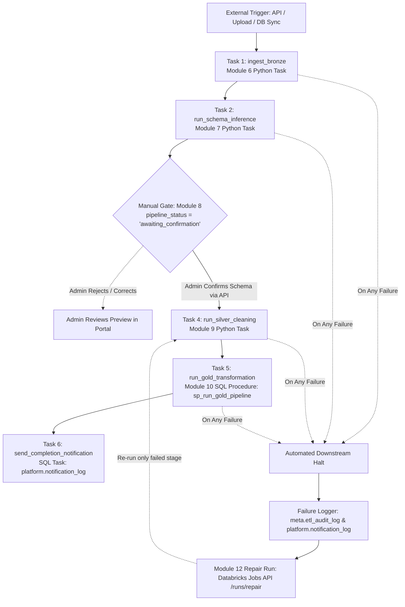

# Helios Databricks Lakeflow Job: Automated Medallion Pipeline

This document details the configuration and architecture of the **Databricks Lakeflow Job** for Helios, connecting Modules 6, 7, 8, 9, and 10 into an automated, multi-tenant Medallion data pipeline. This setup relies entirely on native Databricks Lakeflow capabilities, eliminating any need for an external orchestrator such as Apache Airflow.

> [!NOTE]
> **Glossary Note**: *An organization is called a tenant in the code.* Pipeline jobs, parameters, and metadata columns use `tenant_id` for catalog namespace and volume isolation.

---

## 1. Pipeline Architecture & Task DAG

The pipeline is organized into two stages separated by a **human-in-the-loop confirmation gate** (Module 8):



---

## 2. Lakeflow Tasks Specification

| # | Task Key | Component | Type | Retries | Timeout | Dependencies |
|---|---|---|---|---|---|---|
| **1** | `ingest_bronze` | Module 6 | Python Task (`pipeline/ingestion/run_bronze.py`) | 3 retries (10s backoff) | 60 min | None (Root task) |
| **2** | `run_schema_inference` | Module 7 | Python Task (`pipeline/schema_inference/inference_engine.py`) | 2 retries (10s backoff) | 30 min | `ingest_bronze` |
| **3** | *Manual Gate* | Module 8 | Portal Approval Gate (`awaiting_confirmation`) | N/A | N/A | Waits for admin confirmation API call |
| **4** | `run_silver_cleaning` | Module 9 | Python Task (`pipeline/cleaning/run_silver.py`) | 3 retries (15s backoff) | 60 min | Triggered post-confirmation |
| **5** | `run_gold_transformation` | Module 10 | SQL Task (`CALL helios.gold.sp_run_gold_pipeline(...)`) | 2 retries (15s backoff) | 60 min | `run_silver_cleaning` |
| **6** | `send_completion_notification` | Platform | SQL Task (Writes to `platform.notification_log`) | None | 10 min | `run_gold_transformation` |
| **Alert** | `log_pipeline_failure_alert` | Platform | SQL Task (`run_if: AT_LEAST_ONE_FAILED`) | None | 10 min | Upstream tasks 1, 2, 4, 5 |

---

## 3. Job Execution & Parameter Passing

The Job is configured with parameterized dynamic bindings:

```json
{
  "job_parameters": {
    "tenant_id": "1",
    "batch_id": "batch-7f91a2-2026",
    "source_type": "upload",
    "file_path": "dbfs:/Volumes/helios/raw_uploads/batch-7f91a2-2026.csv",
    "catalog": "helios"
  }
}
```

### Triggering Ingestion Phase (Modules 3, 4, 5)
When a merchant uploads a CSV, triggers a database replication sync, or streams API records, the backend invokes the Databricks Jobs API:

```http
POST /api/2.1/jobs/run-now
Authorization: Bearer <DATABRICKS_TOKEN>
Content-Type: application/json

{
  "job_id": 1049281,
  "job_parameters": {
    "tenant_id": "1",
    "batch_id": "batch-7f91a2-2026",
    "source_type": "upload",
    "file_path": "dbfs:/Volumes/helios/raw_uploads/batch-7f91a2-2026.csv"
  }
}
```

---

## 4. Manual Gate: Admin Approval Mechanism (Module 8)

1. **Pause State**: Task 2 (`run_schema_inference`) matches incoming Bronze headers against candidate templates (`KNOWN_TEMPLATES`), calculates the similarity score, writes inferred column relationships to `platform.inferred_schema`, and sets:
   ```sql
   UPDATE helios.platform.pipeline_status
   SET stage = 'schema_inference', status = 'awaiting_confirmation'
   WHERE batch_id = :batch_id;
   ```
2. **Review**: The batch appears in the Admin Portal under **Pending Approvals** (`/admin/uploads`).
3. **Confirmation**: When the Admin/Team Member reviews the preview at `/admin/confirm-schema/:batchId` and clicks **"Confirm Schema & Trigger Silver"**, the Helios backend:
   - Persists the approval in `platform.inferred_schema` (`confirmed_by = user_id`, `status = 'silver_running'`).
   - Dispatches a Databricks Jobs API call to run the post-confirmation phase starting at `run_silver_cleaning`.

---

## 5. Automated Downstream Halting & Lakeflow Repair Runs (Module 12)

### Automated Failure Halting
Lakeflow Jobs enforce strict upstream dependencies. If `ingest_bronze`, `run_schema_inference`, `run_silver_cleaning`, or `run_gold_transformation` encounters an unhandled exception or data quality fatal error, Lakeflow Jobs automatically halts execution. Dependent downstream tasks are marked as **UPSTREAM_FAILED** without executing.

### Module 12: "Retry from Failed Stage" via Repair Runs
Rather than restarting the entire pipeline from scratch, the Helios Admin Portal uses Lakeflow Jobs' **Repair Run API**:

```http
POST /api/2.1/jobs/runs/repair
Authorization: Bearer <DATABRICKS_TOKEN>
Content-Type: application/json

{
  "run_id": 981240182,
  "rerun_tasks": ["run_silver_cleaning"]
}
```

#### Why This Is Superior
- If `run_silver_cleaning` failed due to a transient data anomaly or downstream timeout, only `run_silver_cleaning` and its downstream tasks (`run_gold_transformation`, `send_completion_notification`) are re-executed.
- The **Bronze data loaded during Task 1 remains untouched and preserved**, avoiding redundant cloud storage reads and duplicate ingestion costs.

---

## 6. Audit & Notification Logging

Failures are tracked across two independent audit stores:

1. **`helios.meta.etl_audit_log`**:
   - Written immediately by each task script/procedure upon failure:
   - Records `batch_id`, `stage` (`bronze_ingest`, `schema_inference`, `silver_clean`, `gold_transform`), `row_count`, `status='failed'`, `started_at`, `completed_at`, and the exact `error_message`.
2. **`helios.platform.notification_log`**:
   - Triggered either by the `log_pipeline_failure_alert` Lakeflow task (`run_if: AT_LEAST_ONE_FAILED`) or directly by the stored procedure exception handlers.
   - Visible to operations staff on the Admin Portal and Dashboard headers.

---

## 7. Deployment Instructions

### Deploy via Databricks Asset Bundle (DAB)
```bash
# Validate bundle definition
databricks bundle validate -t prod

# Deploy Lakeflow Job to Databricks Unity Catalog environment
databricks bundle deploy -t prod

# Execute a test run passing parameters
databricks bundle run helios_medallion_lakeflow_pipeline \
  --params tenant_id=1,batch_id=batch-test-001,source_type=upload
```

### Deploy via Databricks REST API (JSON)
```bash
curl -X POST "${DATABRICKS_HOST}/api/2.1/jobs/create" \
  -H "Authorization: Bearer ${DATABRICKS_TOKEN}" \
  -H "Content-Type: application/json" \
  -d @pipeline/helios_lakeflow_job.json
```
